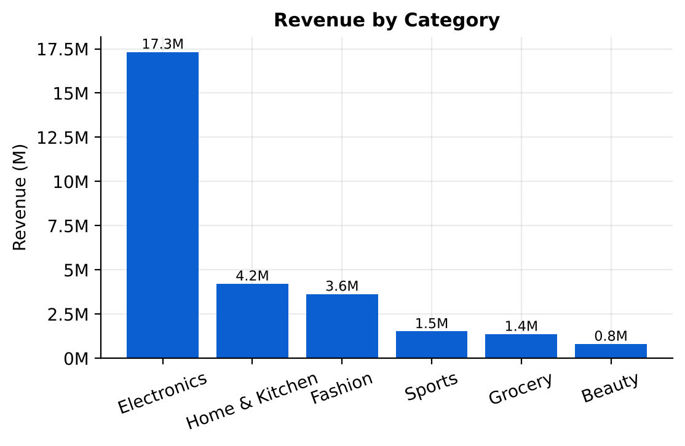
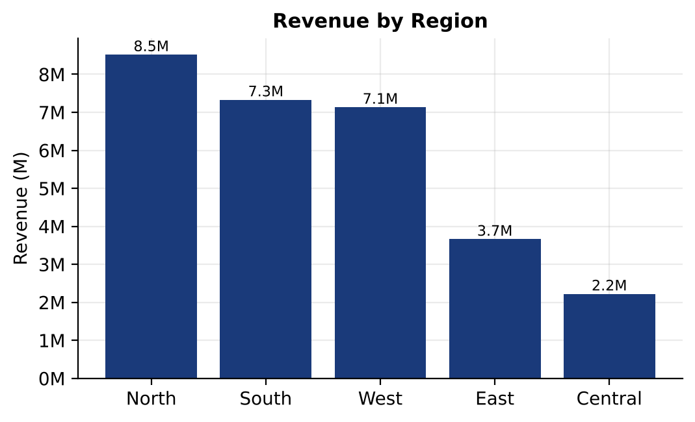
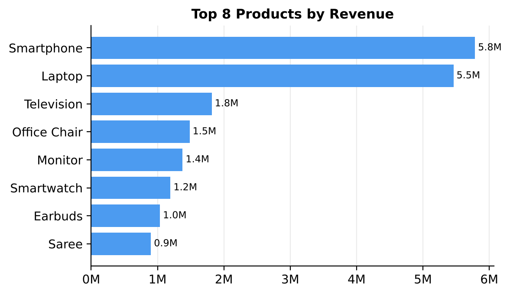
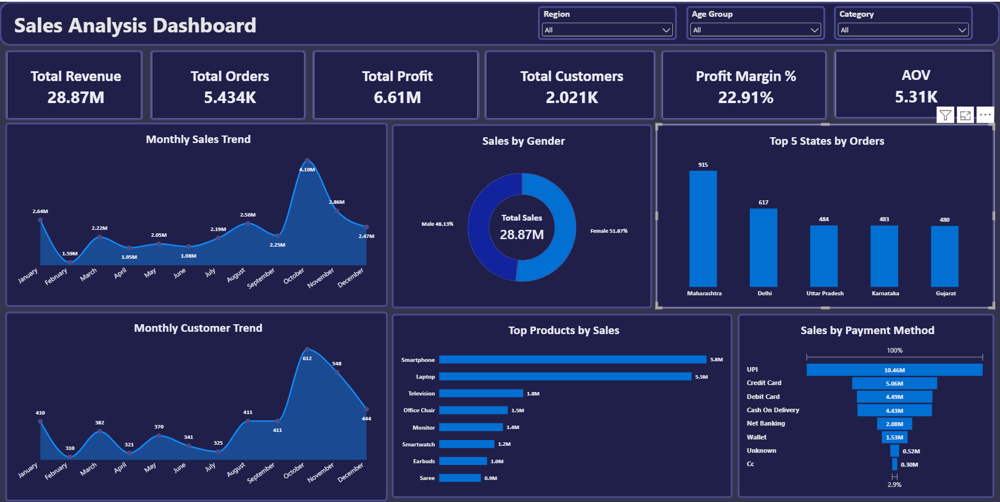

# Indian Retail Sales Analysis: End-to-End Data Analytics Project

> A complete analysis of three years (2023 to 2025) of Indian retail sales data: data cleaning, exploratory data analysis (EDA), visualizations, an interactive Power BI dashboard, business insights and recommendations.


## Project Overview

This project analyses Indian retail sales data from **January 2023 to December 2025**. It covers the full data analytics workflow: Git and GitHub setup, data cleaning with Power Query, EDA, charts with Python, an interactive **Power BI dashboard**, and business recommendations.

## Problem Statement

The business does not know which **products, regions, months and payment methods** bring the most sales. This project finds them, so that the business can plan its stock, marketing and offers better.

## Dataset Description

| Item | Details |
|---|---|
| File | `data/indian_retail_sales_raw.csv` |
| Type | Simulated (generated) Indian retail sales dataset, not private data of a real company |
| Size | 6,160 rows and 23 columns (raw) |
| Period | January 2023 to December 2025 |
| Coverage | 24 Indian cities, 6 categories, 30 products, customers, payment methods, order status |

**Main columns:** OrderID, OrderDate, CustomerID, CustomerName, Gender, Age, Segment, City, State, Region, Category, SubCategory, ProductName, Quantity, UnitPrice, DiscountPct, SalesAmount, Profit, PaymentMethod, ShipMode, DeliveryDays, OrderStatus, CustomerRating.

## Tools Used

- **Git and GitHub:** version control
- **Power Query:** data cleaning
- **Python (pandas, matplotlib):** EDA and charts
- **Power BI (DAX):** interactive dashboard
- **CSV / Excel:** data storage

## Data Cleaning Process

| Problem | Correction |
|---|---|
| Missing Gender, Age, Segment, City, State, UnitPrice | Rows removed |
| Missing DiscountPct, DeliveryDays, CustomerRating | Replaced with 0 |
| Missing PaymentMethod | Replaced with "Unknown" |
| Gender written as M, F, male, female | Changed to Male / Female |
| City names with extra spaces and wrong cases, "New Delhi", "Calcutta" | Trimmed, proper case, corrected |
| Payment names like upi, CC, COD, Netbanking, Debitcard | Standardized |
| Negative Age, Quantity, UnitPrice and Profit values | Converted to positive values |
| Mixed date formats | Converted to one Date type |
| Wrong data types | Changed to Date, Whole Number, Decimal Number, Text |
| Needed for analysis | Added Month Name, Month and Age Group columns |

**Result:** 6,160 raw rows reduced to **5,577 clean rows**.

## Exploratory Data Analysis (EDA)

- Sales depend mainly on **UnitPrice** and **Quantity**. Correlation of SalesAmount with UnitPrice is **0.83** and with Profit is **0.73**.
- Delivery days, customer rating and age have almost no relation with sales.
- The average order line is about 5,177, but the median is only 1,900, so a few very big orders pull the average up.
- A small number of unusual values were found (wrong ages, very high discounts, zero quantity, repeated orders), each under 3% of the rows.


## Visualizations

| | |
|---|---|
|  |  |
|  |  |
|  |  |

## Power BI Dashboard

**Sales Analysis Dashboard** with 6 KPI cards, 6 visuals and 3 slicers (Region, Age Group, Category).



| KPI | Value |
|---|---|
| Total Revenue | 28.87M |
| Total Orders | 5,434 |
| Total Profit | 6.61M |
| Total Customers | 2,021 |
| Profit Margin % | 22.91% |
| Average Order Value (AOV) | 5.31K |

**DAX measures used:** Total Revenue, Total Profit, Total Orders, Total Customers, AOV, Profit Margin %, and an Age Group calculated column.

## Key Insights

1. **Festive season peak:** October is the best month (4.10M revenue, 612 customers). February is the weakest (1.59M, 310 customers).
2. **Steady growth:** Revenue grew from 8.95M (2023) to 9.42M (2024, +5.2%) and 10.50M (2025, +11.5%).
3. **Electronics leads:** Electronics gives 60.0% of revenue. Smartphone (5.78M) and Laptop (5.46M) together give 38.9%.
4. **Top locations:** Maharashtra and Delhi have the most orders. North is the best region (8.52M) and Central is the lowest (2.22M).
5. **UPI is the favourite payment method:** 10.46M (36.2% of revenue), almost double Credit Card.
6. **Balanced customers:** Female customers give 51.9% of revenue and male customers 48.1%.
7. **Returns and cancellations:** 8.2% of order rows were returned or cancelled.

## Business Recommendations

1. **Plan for the festive season:** October and November give 24% of the revenue in 2 months. Stock more Smartphones, Laptops and Televisions, and start campaigns in September.
2. **Increase sales in slow months:** Offers and combo deals in February and April can bring more customers.
3. **Grow East and Central regions:** They are far below North. Local marketing and faster delivery can help.
4. **Promote UPI and reduce returns:** UPI cashback can increase sales, and finding the reasons for returns and cancellations can save revenue.

## Conclusion

The business is growing every year, earns most of its revenue from Electronics, sells the most in October and November, and gets the most payments through UPI. North region and the states of Maharashtra and Delhi lead the sales, while Central region and February need more attention. By planning stock for the festive season, running offers in slow months, growing East and Central regions and promoting UPI, the business can increase its sales further.

## Repository Structure

```
indian-retail-sales-analysis/
├── data/
│   └── indian_retail_sales_raw.csv
├── dashboard/
│   └── Sales_Dashboard.pbix
├── images/
│   └── (charts and dashboard screenshot)
├── Week_6_Final_Project.pdf
└── README.md
```

## Author

**Rahul**
[LinkedIn](https://www.linkedin.com/in/shyam-singh-190b7a2a6) | [GitHub](https://github.com/1m-shyam01) | [Portfolio](https://shyam-analyst.vercel.app)
